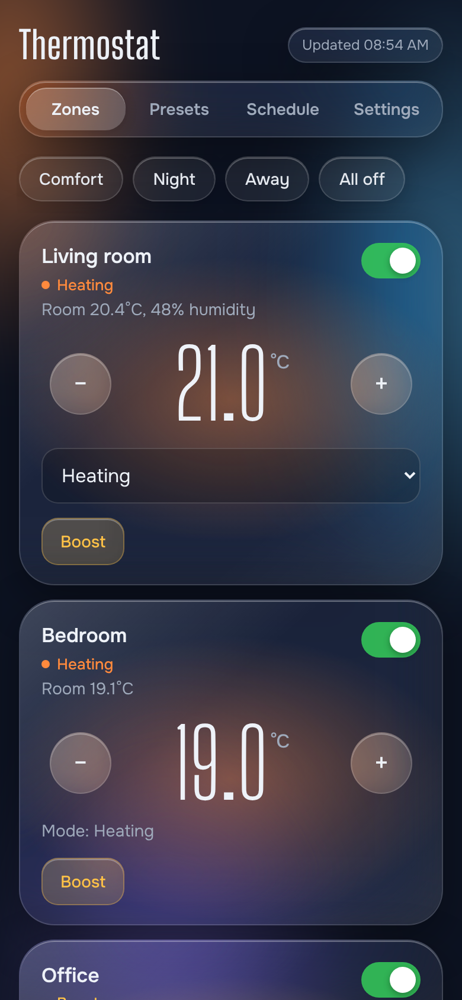
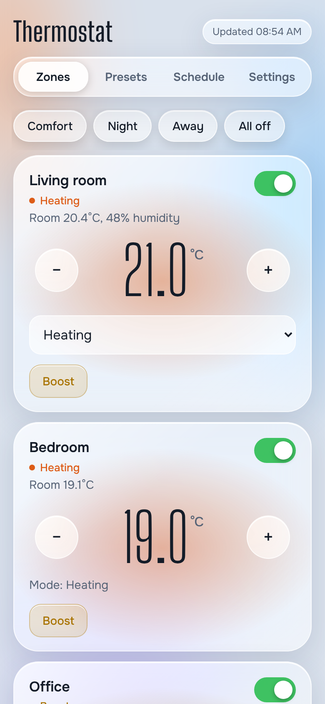
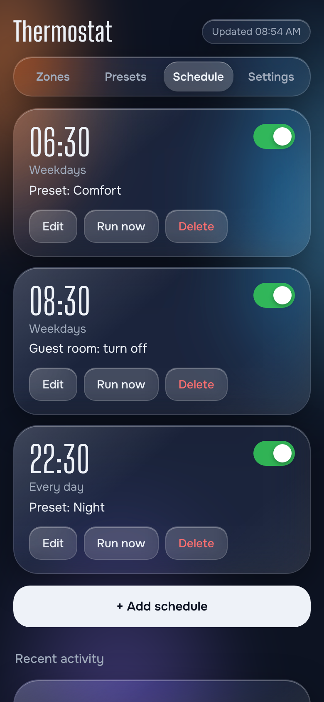

# Airzone Web

A self-hosted web app to control an **Airzone** zoned HVAC system (heating and
cooling) from your phone or computer. It talks to the Airzone gateway on your
home network through its **Local API**, so it needs no cloud account and no
subscription. On top of basic control it adds presets, boost, schedules and
open-window detection.

> **Unofficial project.** Not affiliated with or endorsed by Airzone. Use at
> your own risk.

<p align="center">
  
  
  
</p>

- One Python file, **standard library only**: nothing to install besides Python
  or Docker.
- Phone-friendly "liquid glass" interface, light and dark.
- Everything automatic (schedules, boost end, window pauses) runs on the
  server, so it works even when your phone is off.

---

## Features

| Screen | What you can do |
|---|---|
| **Zones** | See each zone's room temperature and humidity; turn it on/off; set the target temperature; change the mode (on the main zone). One-tap preset buttons. **Boost** a zone for 30 min to 3 h, after which it goes back exactly as it was. |
| **Presets** | Named sets of actions, e.g. *Comfort* = all zones on at 21 °C. Comes with Comfort, Night, Away and All off; create your own. |
| **Schedule** | Run an action at a set time on chosen days: apply a preset, turn on (optionally at a temperature), turn off, or change the temperature. Activity log. |
| **Settings** | Light / dark / automatic appearance; open-window detection; zone order, names and hiding; gateway address; backup and restore. |

Also:
- **Open-window detection** for both seasons: pauses a zone whose temperature
  falls fast while heating, or rises fast while cooling, then puts it back.
- **Offline zones stay visible**, marked offline with their last reading (e.g.
  when a zone thermostat's batteries run out).
- **Commands are queued and spaced out** (1 s apart by default), because the
  gateway can ignore a command that arrives too soon after the previous one.

## Requirements

- An Airzone system with a gateway that exposes the **Local API** on your
  network (port 3000), e.g. an Airzone Webserver or Aidoo. Some gateways need
  a recent firmware for the Local API (3.1.6 or later has been reported).
- A computer that stays on, on the same network: a Raspberry Pi, a NAS, an old
  PC, a virtual machine…
- **Docker** (recommended) or **Python 3.9+**.

Check that your gateway answers before going further (replace the IP with
your gateway's address, which you can find in your router's device list):

```bash
curl -X POST http://192.168.1.50:3000/api/v1/hvac -d '{"systemID":1,"zoneID":0}'
```

You should get JSON listing your zones (`"name"`, `"roomTemp"`, `"setpoint"`…).

## Quick start with Docker

1. Download this repository (green **Code** button → **Download ZIP**, or
   `git clone`) onto the machine that will run the app.
2. Open `compose.yaml` and set:
   - `TZ` to your time zone (e.g. `Europe/Paris`, `America/New_York`).
     Schedules use it.
   - `AIRZONE_IP` to your gateway's IP address. Optional: you can also enter
     it later in the app under **Settings → Thermostat connection**.
3. In that folder, run:

   ```bash
   docker compose up -d --build
   ```

4. Open `http://<machine-ip>:8080` in a browser.

Your data (schedules, presets, settings) is kept in the `data/` folder next to
`compose.yaml`.

**Update** to a newer version: replace `server.py` (or download the new
release), then run `docker compose up -d --build` again. Your data is kept.

## Running without Docker

```bash
AIRZONE_IP=192.168.1.50 python3 server.py
```

Then open `http://localhost:8080`. Data is saved next to `server.py`. On
Windows (PowerShell): `$env:AIRZONE_IP="192.168.1.50"; python server.py`.

## Access from outside your home

**Do not expose this app or the Airzone gateway to the internet** (no port
forwarding). Neither has a login, and the gateway's Local API has no
authentication or encryption at all.

Use a private VPN instead. [Tailscale](https://tailscale.com) is the easiest:
install it on the machine running the app and on your phone, sign in to the
same account, and open `http://<machine-name>:8080` from anywhere. WireGuard
or your router's built-in VPN work too.

---

## Using the app

### Presets
Tap a preset at the top of **Zones**, or **Apply** in **Presets**. Each preset
line is a zone (or *All zones*), an action (Turn on, Turn off, Set
temperature) and a temperature. *All zones* lines run first, so a line for a
single zone can override them.

### Boost
On a zone, tap **Boost**, pick a temperature and a duration (30 min, 1 h, 2 h
or 3 h). When it ends, or when you tap **Stop**, the zone returns to exactly
how it was.

### Schedules
Each schedule has a time, days (shortcuts: Weekdays, Weekend, Every day) and an
action. They follow the server's clock, so set `TZ` correctly.

### Open-window detection
Off by default; turn it on in **Settings**.

| Setting | Default | Meaning |
|---|---|---|
| Change of | 1.0° | How much the temperature must fall (heating) or rise (cooling)… |
| Within | 10 min | …in how long, to count as an open window |
| Pause | 20 min | How long the zone stays off |

Only zones that are on and in **Heating** or **Cooling** mode are watched.
Each zone shows a live reading (e.g. *Heating. Live: −0.4°*). To tune the
threshold, open a window with detection off, watch the reading, and set the
threshold a little below what you saw. After a pause, a zone is ignored for 15
minutes while it recovers.

### What happens when actions overlap
- A schedule or preset that changes a zone ends its boost or window pause; the
  new setting stays.
- A manual on/off or temperature change ends a window pause; a boost keeps
  running and still restores at the end.
- While a zone is **offline**, presets and *All zones* schedules skip it (and
  say so), a schedule for that zone alone is logged as failed, and Boost is
  refused. A boost or pause that ends while it's offline waits until it
  reconnects.

### Settings
- **Appearance:** Automatic (follows your device), Light or Dark. Saved per
  device.
- **Zones:** reorder with ↑ / ↓, hide zones from the Zones screen (display only:
  *All zones* actions still include them), rename them for this app, and
  forget a zone that is permanently gone.
- **Thermostat connection:** gateway IP and port, with a **Test** button. Once
  saved here, it takes priority over `AIRZONE_IP`.
- **Backup:** download settings, presets and schedules as one JSON file, and
  restore it later (also on a new install).

---

## Configuration

Environment variables (set them in `compose.yaml` under `environment`):

| Variable | Default | Notes |
|---|---|---|
| `AIRZONE_IP` | *(none)* | Gateway IP. Can also be set in Settings, which then takes priority. |
| `AIRZONE_PORT` | `3000` | Local API port |
| `PORT` | `8080` | Port the app listens on |
| `TZ` | system | Time zone used by schedules |
| `SCHEDULE_FILE` | `schedules.json` next to `server.py` (`/data/schedules.json` in Docker) | |
| `DATA_DIR` | folder of `SCHEDULE_FILE` | Where the other data files go |
| `SAMPLE_SECONDS` | `60` | How often temperatures are read for window detection |
| `LOOP_SECONDS` | `20` | How often schedules, boosts and pauses are checked |
| `WRITE_GAP` | `1.0` | Seconds to wait after each command sent to the gateway. Raise it if some changes are ignored. |

### Data files

| File | Contents |
|---|---|
| `schedules.json` | Schedules |
| `presets.json` | Presets (four defaults created on first start) |
| `settings.json` | Gateway address, zone names / order / hidden, window detection settings |
| `boosts.json`, `windows.json` | Boosts and window pauses currently running |
| `zones.json` | Every zone seen, with its last readings (keeps offline zones visible) |

## Troubleshooting

| Problem | What to check |
|---|---|
| "No thermostat address set yet" | Enter the gateway IP in **Settings → Thermostat connection**, or set `AIRZONE_IP`. |
| "Thermostat unreachable" | Is the gateway's IP still the same? (Give it a fixed IP / DHCP reservation in your router.) Run the `curl` test above from the machine running the app. `docker compose logs` shows errors. |
| The `curl` test fails | The Local API may need a firmware update of the gateway. Some users report the gateway stops answering locally when it loses internet access. |
| One zone shows "Offline" | That zone's thermostat isn't answering the gateway: check its batteries and radio range. |
| A change is sometimes ignored | Increase `WRITE_GAP` (e.g. `"2"`), then `docker compose up -d`. |
| Schedules run at the wrong hour | Set `TZ` in `compose.yaml`, then `docker compose up -d`. |

## How it works

`server.py` is a small HTTP server (Python standard library) that:
- reads zones with `POST /api/v1/hvac {"systemID":0,"zoneID":0}` (falling back
  to `systemID 1`) and changes them with `PUT /api/v1/hvac`, one parameter per
  request (`on`, `mode`, `setpoint`);
- runs a background loop for schedules, boost and pause expiry, and
  temperature sampling;
- serves the whole web page (HTML, CSS, JS and the two fonts) from the same
  file, so it works without internet access.

It has been tested against a simulated gateway and used on one real Airzone
installation. Airzone systems vary, so reports of what works (or doesn't) on
yours are very welcome: please open an issue.

## Contributing

Issues and pull requests are welcome. Please keep it a single file with no
dependencies. `CLAUDE.md` contains technical notes on the design and on how to
test without a real gateway.

## License and credits

- Code: [MIT License](LICENSE).
- Fonts embedded in `server.py`: **Big Shoulders Display** and **Onest**, both
  under the SIL Open Font License 1.1 (via the @fontsource packages).
- Airzone is a trademark of its owner. This project is independent and not
  affiliated with Airzone.
